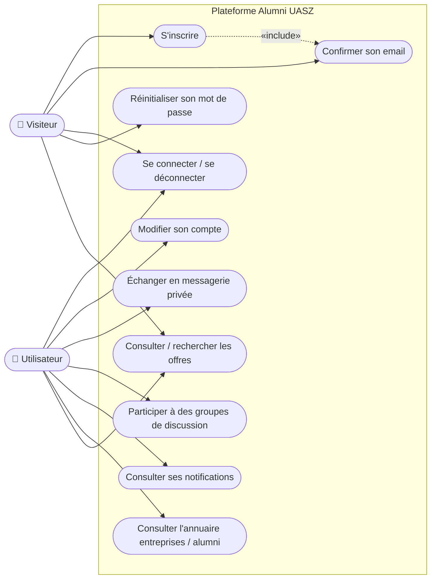
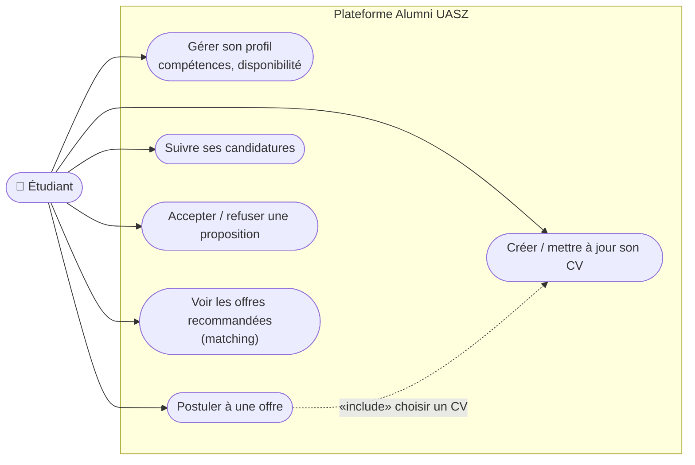
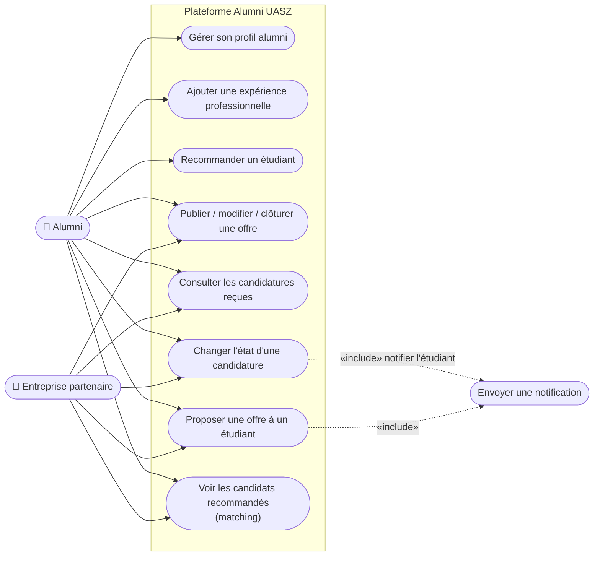
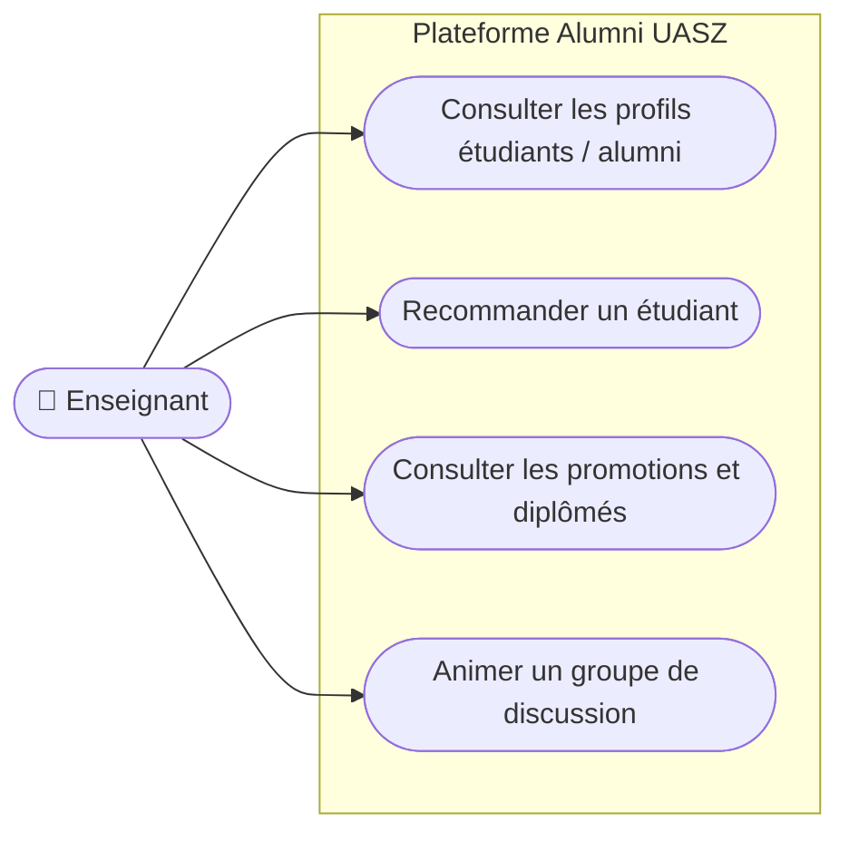
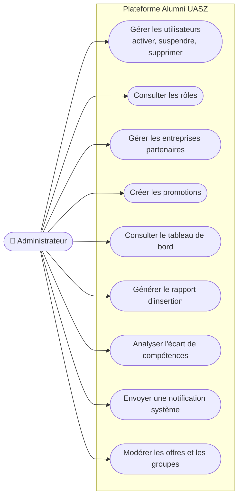

# Diagrammes de cas d'utilisation (par rôle)

Rôles définis dans `RoleName` (`user-service`) : **ETUDIANT**, **ALUMNI**, **ENSEIGNANT**, **ADMINISTRATEUR**.
L'acteur **Entreprise partenaire** (cahier des besoins, AL-62) n'a pas encore de rôle propre dans le contrat
(voir [architecture.md, §8](../architecture.md#8-points-ouverts)).

## Cas communs à tous les utilisateurs authentifiés

## Étudiant

## Alumni et Entreprise partenaire

## Enseignant

## Administrateur

