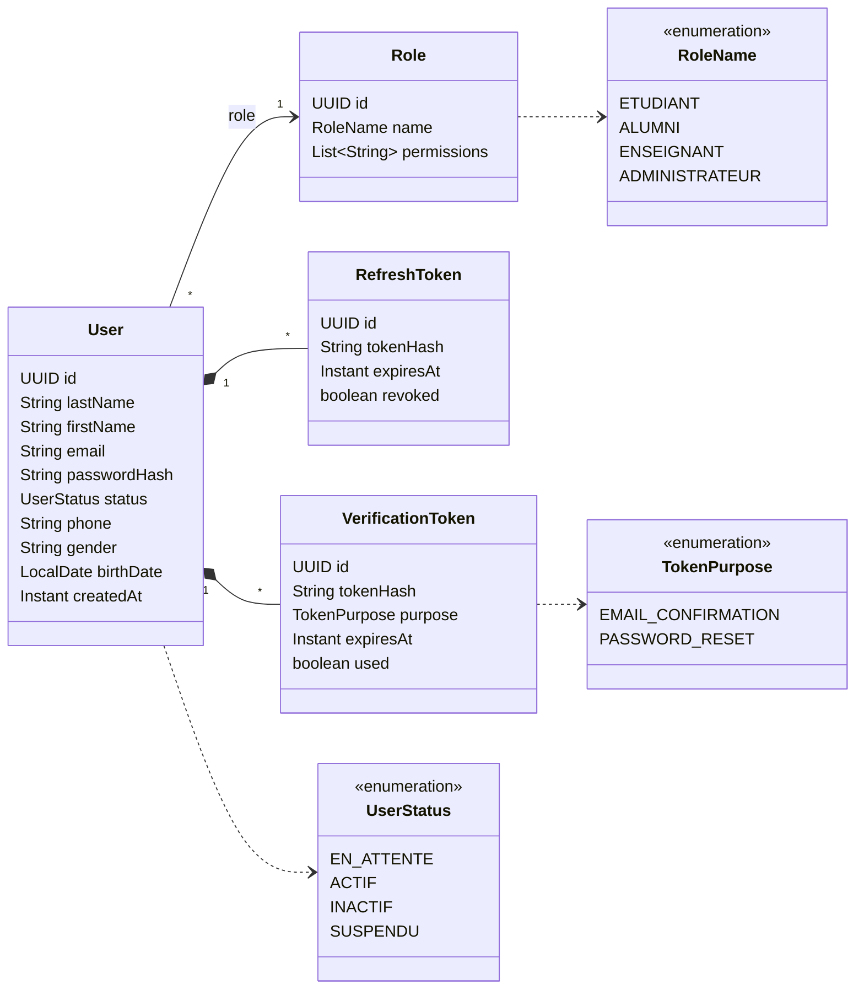
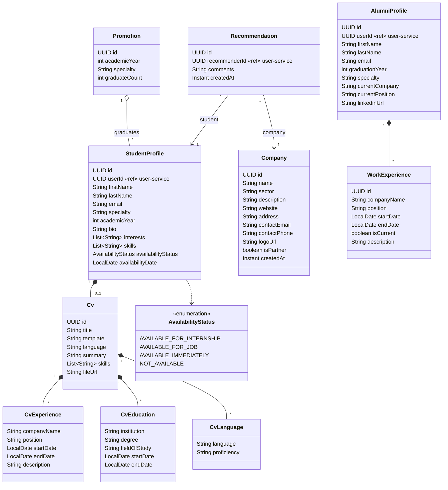
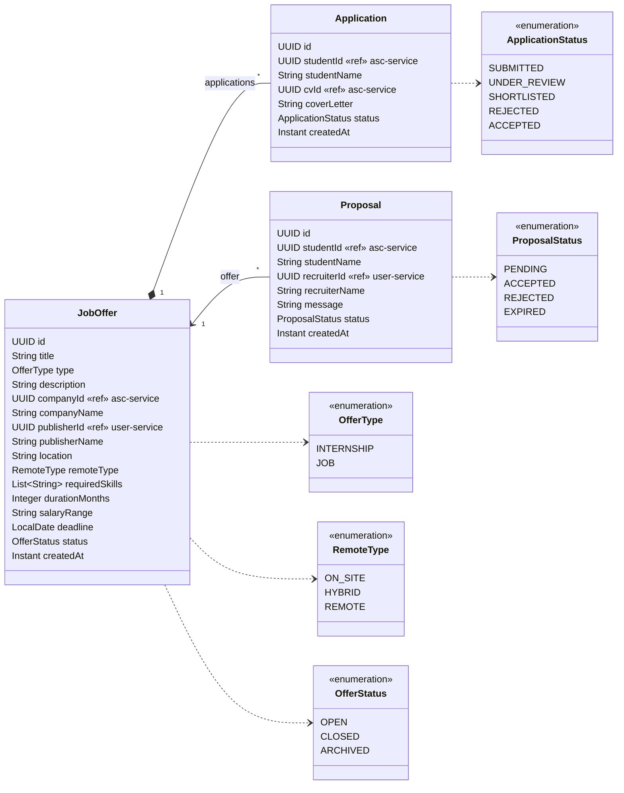
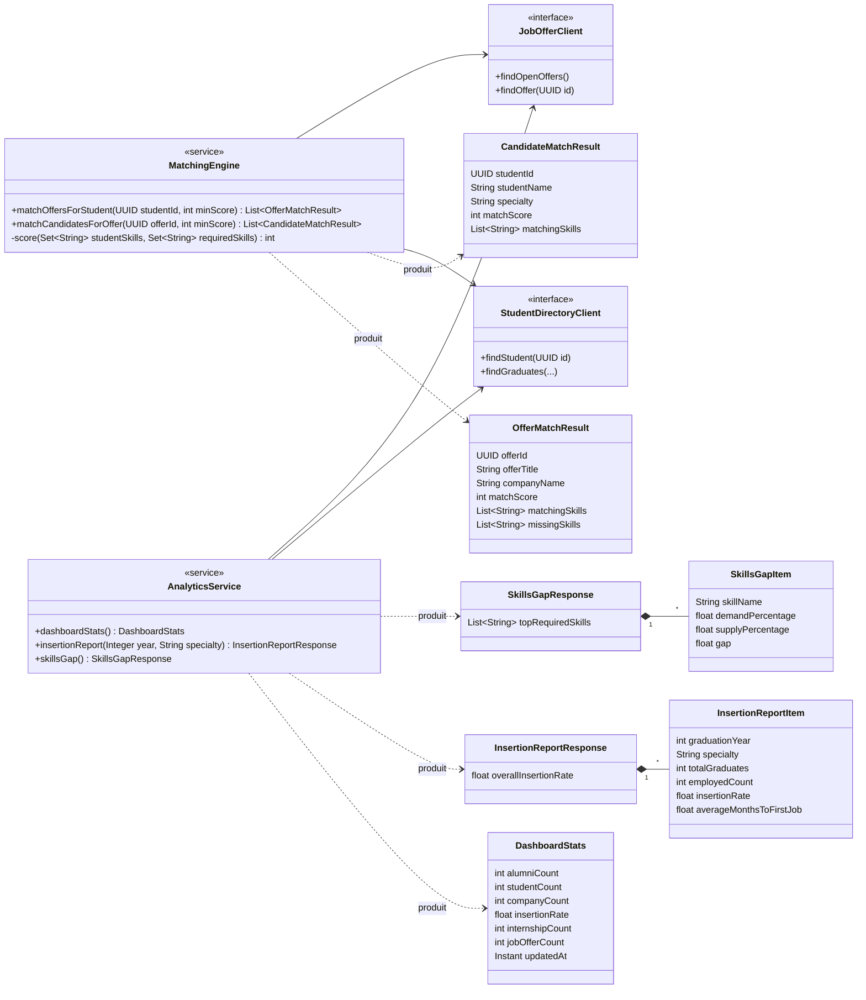
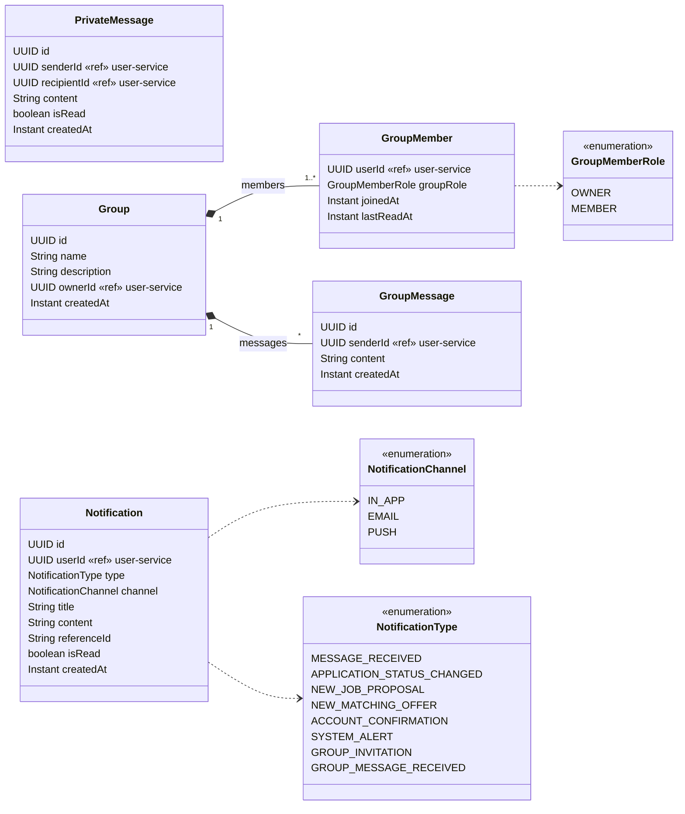

# Diagrammes de classes (par service)

**Modèle de domaine cible** de chaque service. Il est dérivé des contrats OpenAPI v1.0.0 et servira de base
aux entités JPA (`model/`) et aux migrations Flyway.
Les références vers les données d'un **autre service** sont de simples UUID (pas de clé étrangère entre
bases). Elles sont marquées `«ref» Service`.

## 1. user-service

> `RefreshToken`, `VerificationToken` et `passwordHash` ne figurent pas dans le contrat. Ce sont des classes
> internes, nécessaires aux opérations `/auth/refresh-token`, `/auth/logout`, `/auth/confirm-email` et
> `/auth/reset-password`.

## 2. alumni-student-company-service

## 3. job-offer-service

## 4. analytics-matching-service

Ce service calcule ses résultats à partir des données des autres services. Ses classes sont surtout des
**objets de calcul** (non persistés) et un éventuel cache de statistiques.

## 5. notification-messaging-service

> `GroupMember.lastReadAt` est interne. Il sert à calculer `GroupSummary.unreadCount` et
> `PATCH /messages/groups/{groupId}/read`. `ConversationSummary` est une vue calculée sur `PrivateMessage`.
