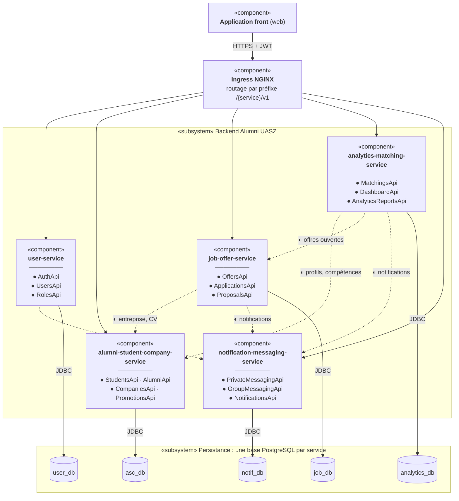

# Diagramme de composants

Composants logiciels de la plateforme et interfaces (fournies ●, requises ◐) entre eux.
Chaque interface fournie correspond à un contrat OpenAPI de [`contracts/`](../../contracts/).

## Lecture

| Élément | Signification |
| --- | --- |
| ● dans un composant | Interface **fournie** par le composant : interfaces Java `*Api` générées depuis le contrat |
| ◐ « notifications » | Appel de `POST /notifications/send` |
| Flèche pleine | Appel REST entrant via l'ingress, ou accès JDBC à la base du service |
| Flèche pointillée ◐ | Interface **requise** : appel REST de service à service, authentifié par un jeton de service (ADR-0010) |
| Interfaces `*Api` | Générées depuis `contracts/*.yaml` dans les artefacts Maven `*-spi:1.0.0` et implémentées par les contrôleurs de chaque composant (voir le [diagramme de packages](packages.md)) |

Le JWT émis par `user-service` est vérifié **localement** par chaque service avec un secret partagé.
Il n'y a donc pas de dépendance à `user-service` à l'exécution pour l'authentification.
