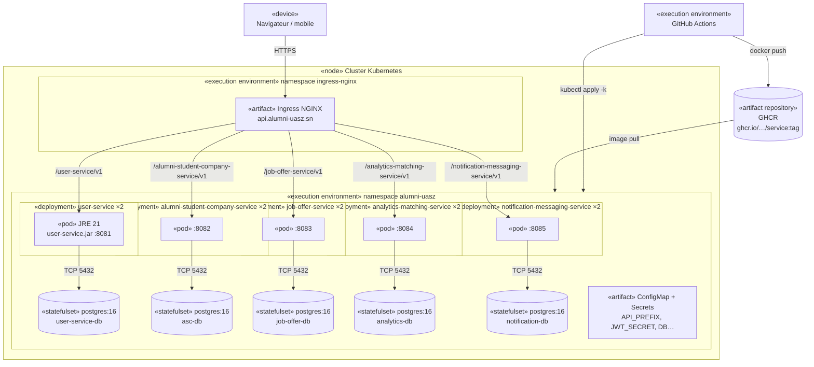
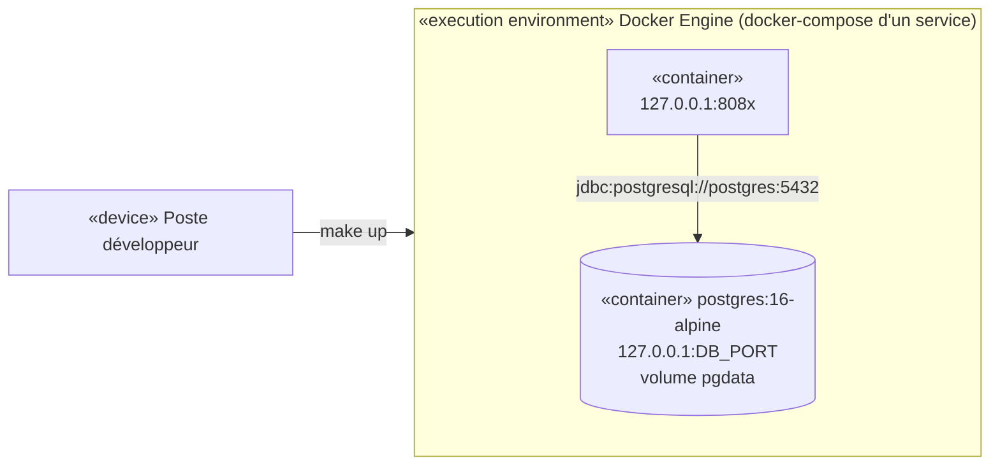

# Diagramme de déploiement

## Cible Kubernetes (dev avec kind, prod avec le même manifeste)

| Élément | Détail (manifestes `*/k8s/`) |
| --- | --- |
| Deployment | 2 réplicas, `RollingUpdate` (`maxUnavailable: 0`, `maxSurge: 1`), arrêt gracieux de 30 s |
| Pod | Image `eclipse-temurin` JRE 21, non root (UID 10001), seccomp `RuntimeDefault`, 200m–1 CPU, 384–512 Mi |
| Sondes | `/actuator/health/liveness` et `/actuator/health/readiness` |
| Configuration | `ConfigMap` (port, préfixe, CORS, émetteur JWT) ; `Secrets` (`JWT_SECRET`, identifiants de la base) |
| Base de données | Overlay `dev` : `StatefulSet` `postgres:16-alpine` avec un PVC de 1 Gi par service. En prod : base gérée ou StatefulSet dédié |
| Ingress | Classe `nginx`, un chemin `Prefix` par service |

## Poste de développement (docker-compose)

