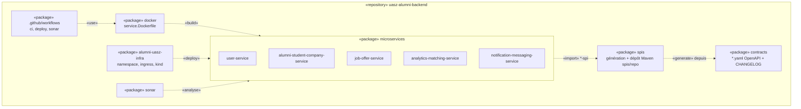
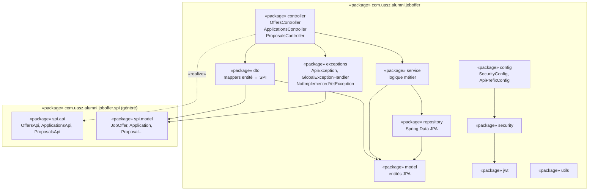

# Diagramme de packages

## Vue d'ensemble du monorepo

## Structure interne d'un microservice

Tous les services ont la même structure. Exemple : `job-offer-service`
(`com.uasz.alumni.joboffer`). Les autres racines sont `...user`, `...alumnistudentcompany`,
`...analyticsmatching` et `...notificationmessaging`.

## Règles de dépendance

- `controller` ne dépend que de `service`, de `dto` et des interfaces SPI. Il n'accède jamais au `repository`.
- Les entités (`model`) ne sortent jamais du service. On expose uniquement les modèles `spi.model` via `dto`.
- Le package `spi` est **généré**. On ne le modifie pas à la main : on modifie le contrat.
