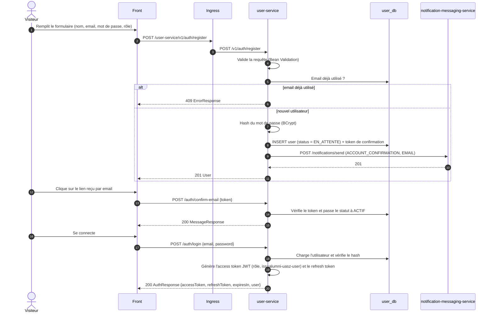
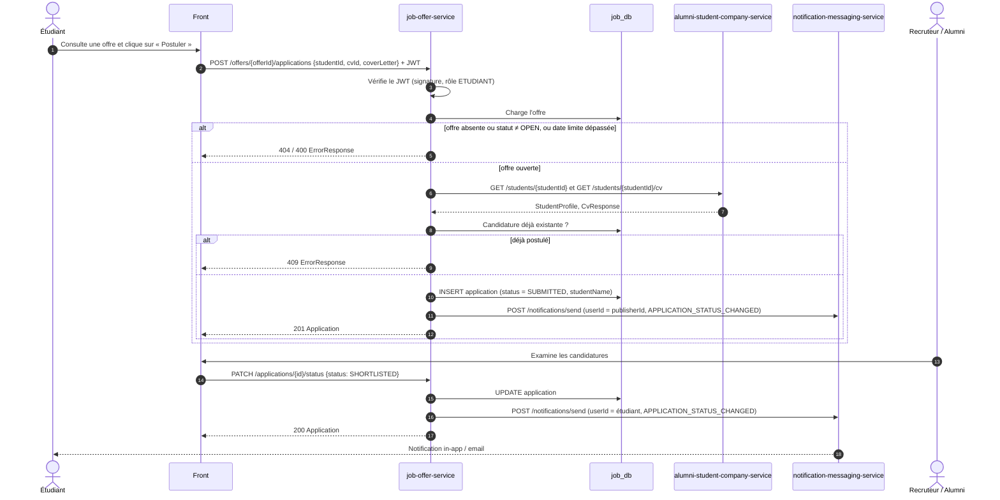
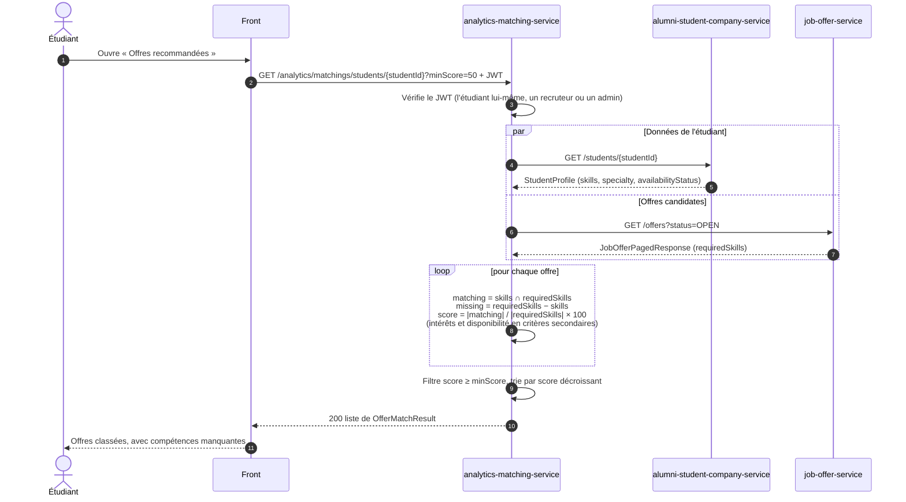

# Diagrammes de séquence des flux clés

Flux cibles décrits à partir des contrats OpenAPI. Les appels de service à service sont en REST
synchrone, avec propagation du JWT de l'appelant.

## 1. Inscription et activation du compte

## 2. Candidature à une offre

## 3. Matching étudiant → offres

